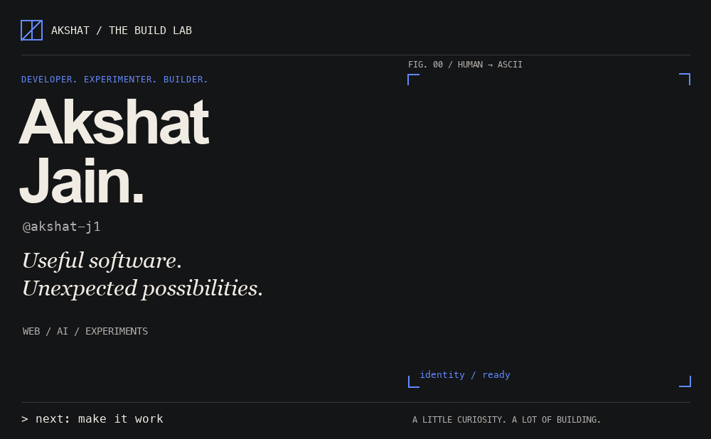

<picture>
  <source media="(max-width: 600px) and (prefers-reduced-motion: reduce)" srcset="assets/hero-ascii-mobile-static.png">
  <source media="(prefers-reduced-motion: reduce)" srcset="assets/hero-ascii-static.png">
  <source media="(max-width: 600px)" srcset="assets/hero-ascii-mobile.gif">
  
</picture>

  <a href="#01--a-few-things-ive-built">Selected builds</a> &nbsp; / &nbsp;
  <a href="#02--inside-the-lab">Inside the lab</a> &nbsp; / &nbsp;
  <a href="#03--field-recordings">Activity</a> &nbsp; / &nbsp;
  <a href="#05--keep-in-touch">Connect</a>

I'm **Akshat**. I like turning a “what if?” into something you can actually use — or something that makes an ordinary Google Meet a little less ordinary.

My work moves between **full-stack applications, practical AI experiments, and playful browser tools**. Lately, that has meant local computer vision, weather intelligence, and language assessment. Hackathons are another excuse to take an idea seriously enough to build it.

## 01 / A few things I've built

<a href="https://github.com/akshat-j1/meetflix">
  <picture>
    <source media="(max-width: 600px)" srcset="assets/project-01-mobile.svg">
    
  </picture>
</a>

**[MEETFLIX](https://github.com/akshat-j1/meetflix)** · A CodeDay submission. Four visual effects, three gesture triggers, and locally processed camera frames. Built as a Chrome Manifest V3 extension; install from source.

 

<a href="https://github.com/akshat-j1/sih26069-weather-platform">
  <picture>
    <source media="(max-width: 600px)" srcset="assets/project-02-mobile.svg">
    
  </picture>
</a>

**[National Weather Big Data Analytics Platform](https://github.com/akshat-j1/sih26069-weather-platform)** · Built around Smart India Hackathon problem statement **SIH26069**. A full-stack project with report ingestion, Redis-backed pipelines, map dashboards, and explainable credibility scoring.

 

<a href="https://github.com/akshat-j1/linguacert-ai">
  <picture>
    <source media="(max-width: 600px)" srcset="assets/project-03-mobile.svg">
    
  </picture>
</a>

**[LinguaCert AI](https://github.com/akshat-j1/linguacert-ai)** · Exploring AI-assisted English assessment across reading, listening, speaking, and writing. Next.js interfaces, Supabase data and authentication, and Gemini integration.

[Browse the rest of the lab ↗](https://github.com/akshat-j1?tab=repositories)

## 02 / Inside the lab

<picture>
  <source media="(max-width: 600px)" srcset="assets/stack-mobile.svg">
  
</picture>

Tools used in the featured repositories. A working toolkit, always evolving.

## 03 / Field recordings

<a href="https://github.com/akshat-j1?tab=overview">
  <picture>
    <source media="(max-width: 600px)" srcset="assets/activity-mobile.svg">
    
  </picture>
</a>

Generated from GitHub's contribution calendar and public repository API. Contributions include more than commits; the latest week is partial. Languages count owned repositories by their primary language, excluding forks and unclassified repositories. Scheduled refreshes retain the last successful data if a source fails.

## 04 / Beyond the solo build

**A small contribution, merged.** Updated project documentation in [Turing-agent · PR #3](https://github.com/YASHK-arch/Turing-agent/pull/3), merged on 29 October 2026.

**Built for the challenge.** [MEETFLIX](https://github.com/akshat-j1/meetflix#readme) is documented as a CodeDay submission; the [weather platform](https://github.com/akshat-j1/sih26069-weather-platform#readme) tackles SIH26069.

## 05 / Keep in touch

Have an idea, a question, or a useful rabbit hole?

**[Find me on GitHub ↗](https://github.com/akshat-j1)** · **[Explore my public work ↗](https://github.com/akshat-j1?tab=repositories)**

 

<picture>
  <source media="(max-width: 600px)" srcset="assets/footer-mobile.svg">
  
</picture>
